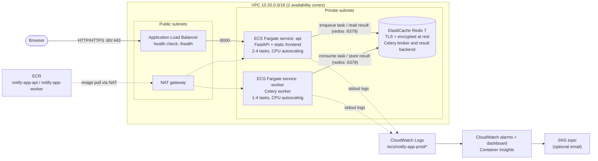
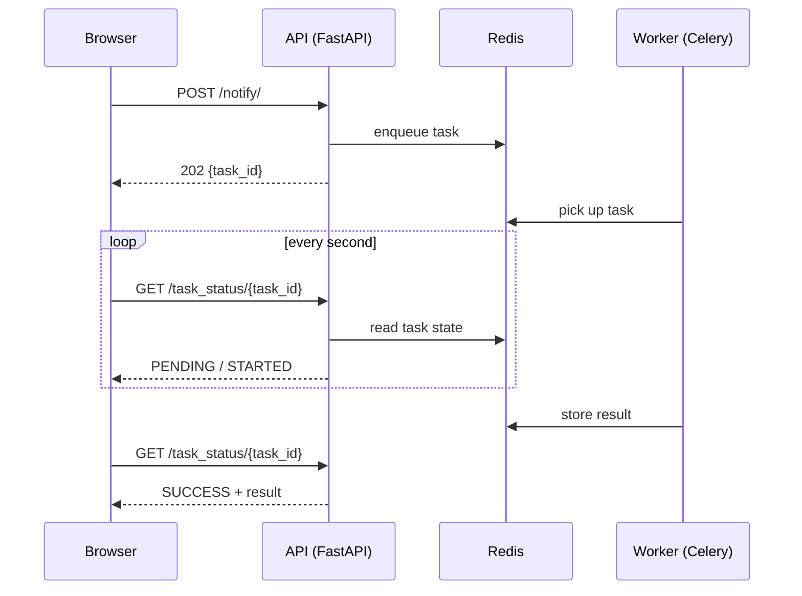
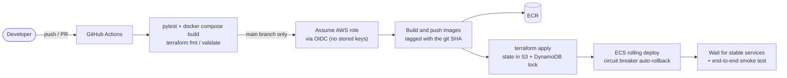

# Architecture

## Runtime (AWS)

Security groups: the internet can only reach the ALB. The API accepts traffic
only from the ALB, the worker accepts no inbound traffic, and Redis accepts
connections only from the API and worker security groups.

## Request flow

## Delivery pipeline

## One-time bootstrap (`infra/bootstrap`)

The pipeline depends on a few resources it cannot create for itself, so they
are applied once by hand: the S3 state bucket and DynamoDB lock table, the two
ECR repositories, and the GitHub OIDC provider with the deploy role.
